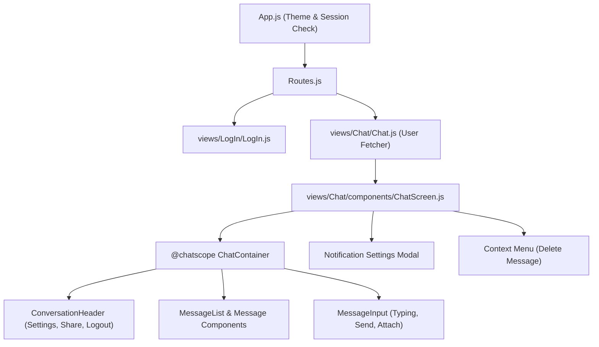
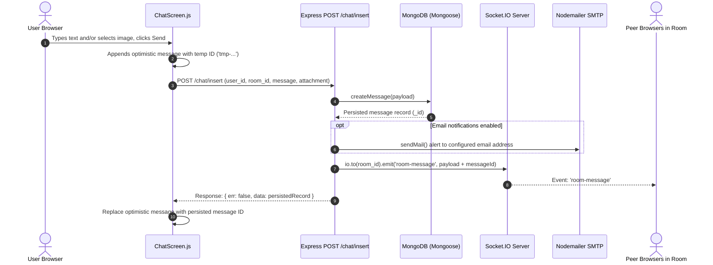
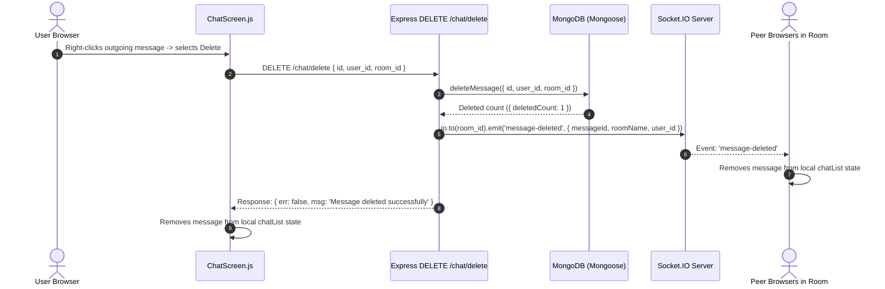

# Application Architecture

## 1. High-Level System Architecture

The application is organized as a decoupled client-server monorepo:

```mermaid
graph TD
    UserBrowser["User Browser (React SPA)"] -->|HTTP REST API (Axios)| ExpressServer["Express API Server (Node.js)"]
    UserBrowser <-->|WebSocket Events| SocketIOServer["Socket.IO Server (port 5000)"]
    ExpressServer -->|req.app.get('io')| SocketIOServer
    ExpressServer -->|Database Queries| MongoDB["MongoDB via Mongoose (server/db/index.js)"]
    ExpressServer -->|SMTP Alert Trigger| Mailer["Nodemailer SMTP Server"]
```

- **Frontend:** Single-page application written in React (16.8.6) leveraging Material-UI v4, Redux Toolkit, and `@chatscope/chat-ui-kit-react`.
- **Backend:** Node.js (18) running Express 4 and Socket.IO 4 in an integrated HTTP server instance ([server/server.js](file:///w:/shubham/personal/Realtime-Chat-App/server/server.js)).
- **Database Layer:** MongoDB via Mongoose providing an asynchronous JS query interface ([server/db/index.js](file:///w:/shubham/personal/Realtime-Chat-App/server/db/index.js)).
- **Messaging/Notifications:** Dual-channel notifications — in-browser Web Notifications and server-side SMTP email dispatch.

---

## 2. Frontend Architecture

### 2.1 File & Directory Layout
- **Root Entry:** [client/src/index.js](file:///w:/shubham/personal/Realtime-Chat-App/client/src/index.js) initializes the Redux store provider and mounts [App.js](file:///w:/shubham/personal/Realtime-Chat-App/client/src/App.js).
- **Core App Container:** [client/src/App.js](file:///w:/shubham/personal/Realtime-Chat-App/client/src/App.js) is a class component that manages Material-UI ThemeProvider, checks existing session tokens in `localStorage`, decodes JWTs, updates Redux, and controls browser history navigation.
- **Routing:** [client/src/Routes.js](file:///w:/shubham/personal/Realtime-Chat-App/client/src/Routes.js) defines application routes with layout wrapping using custom routing wrappers:
  - `/` &rarr; Redirects to `/chat/:chatURL` if logged in, otherwise `/login`.
  - `/login` and `/login/:url` &rarr; [LogIn](file:///w:/shubham/personal/Realtime-Chat-App/client/src/views/LogIn/LogIn.js) view inside [Minimal](file:///w:/shubham/personal/Realtime-Chat-App/client/src/layouts/Minimal/Minimal.js) layout.
  - `/chat/:url` &rarr; [Chat](file:///w:/shubham/personal/Realtime-Chat-App/client/src/views/Chat/Chat.js) view wrapped in [PrivateRouteWithLayout](file:///w:/shubham/personal/Realtime-Chat-App/client/src/components/PrivateRouteWithLayout/PrivateRouteWithLayout.js).
- **State Management:** [client/src/store/store.js](file:///w:/shubham/personal/Realtime-Chat-App/client/src/store/store.js) configures a single Redux store containing the `auth` slice ([client/src/store/authSlice.js](file:///w:/shubham/personal/Realtime-Chat-App/client/src/store/authSlice.js)).
- **API Client:** [client/src/api/api-client.js](file:///w:/shubham/personal/Realtime-Chat-App/client/src/api/api-client.js) provides a pre-configured Axios instance using `process.env.REACT_APP_API_URL`.

### 2.2 Component Hierarchy & Structure



---

## 3. Backend Architecture

### 3.1 Server Structure
- **Entry Point:** [server/server.js](file:///w:/shubham/personal/Realtime-Chat-App/server/server.js) creates an HTTP server with Express and attaches Socket.IO to the same server.
- **CORS & Origin Handling:** Dynamic origin validation based on `CLIENT_URL`, `SERVER_URL`, and comma-delimited `ALLOWED_ORIGINS`.
- **Payload Limits:** Configured with `express.json({ limit: "20mb" })` to accommodate base64 image data strings.
- **Route Mounting:**
  - `/auth` &rarr; [server/routes/auth.js](file:///w:/shubham/personal/Realtime-Chat-App/server/routes/auth.js)
  - `/users` &rarr; [server/routes/users.js](file:///w:/shubham/personal/Realtime-Chat-App/server/routes/users.js)
  - `/chat` &rarr; [server/routes/chat.js](file:///w:/shubham/personal/Realtime-Chat-App/server/routes/chat.js)

### 3.2 Real-time & WebSocket Architecture
Socket.IO handlers are attached in [server/server.js](file:///w:/shubham/personal/Realtime-Chat-App/server/server.js#L57-L107):
- Rooms are formed using Socket.IO `socket.join(roomName)`.
- Client attaches room metadata on `socket.data.roomName`.
- The Express app stores the Socket.IO instance via `app.set("io", io)`, enabling REST route controllers to broadcast real-time events to connected sockets in a room (e.g. `POST /chat/insert` and `DELETE /chat/delete`).

---

## 4. Database Layer (MongoDB / Mongoose)

The database access layer is defined in [server/db/mongo.js](file:///w:/shubham/personal/Realtime-Chat-App/server/db/mongo.js) and exported via [server/db/index.js](file:///w:/shubham/personal/Realtime-Chat-App/server/db/index.js):

Methods exposed by the database module:
- `getUserByUsername(username)`
- `getUserById(id)`
- `createUser({ username, chatURL })`
- `getAllUsers()`
- `getUserByFilter({ userId, ignoreUserId })`
- `updateUser(id, fields)`
- `createMessage(payload)`
- `getMessagesByRoomId(roomId)`
- `deleteMessage({ id, user_id, room_id })`

---

## 5. End-to-End Data Flows

### 5.1 Sending a Chat Message


### 5.2 Deleting a Message


---

## 6. Integrations & External Services

1. **SMTP Server:** Configured via `SMTP_HOST`, `SMTP_PORT`, `SMTP_USER`, `SMTP_PASS` in [server/routes/chat.js](file:///w:/shubham/personal/Realtime-Chat-App/server/routes/chat.js). Used to send email alerts on incoming chat messages.
2. **Oracle Cloud Infrastructure (OCI):**
   - Registry: OCIR (`bom.ocir.io/bm9iljpbnagj`) used as Docker container registry.
   - Compute VM: Automated SSH deployment via GitHub Actions in [.github/workflows/](file:///w:/shubham/personal/Realtime-Chat-App/.github/workflows).
3. **HTML5 Browser APIs:**
   - Web Notification API for native desktop popups.
   - Clipboard API for copying invite links (`navigator.clipboard.writeText`).
   - FileReader API for client-side image-to-Base64 encoding.
